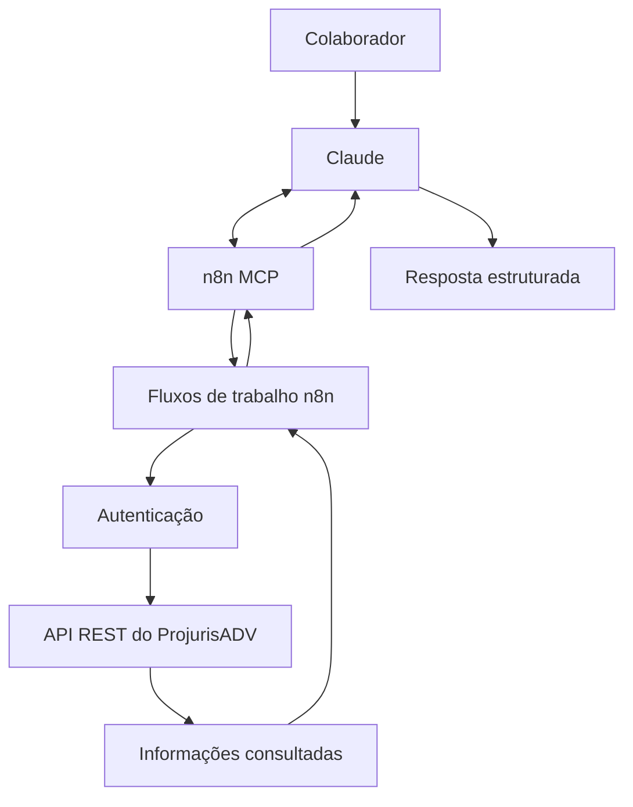

# Arquitetura Técnica

## Visão geral

O projeto integrou o Claude, os recursos nativos de Model Context Protocol (MCP) do n8n e a API REST do ProjurisADV para disponibilizar consultas de informações jurídicas por meio de linguagem natural.

A arquitetura foi organizada para separar a interação com o usuário, a orquestração dos fluxos de trabalho e a comunicação com a API do sistema jurídico.

## Componentes da arquitetura

### 1. Claude

O Claude atuava como interface de interação em linguagem natural.

Suas responsabilidades incluíam:

- Interpretar as solicitações dos usuários.
- Identificar quais informações precisavam ser consultadas.
- Utilizar as ferramentas disponibilizadas por meio do MCP do n8n.
- Organizar as informações recuperadas em respostas estruturadas.

### 2. n8n e MCP

O n8n era responsável pela orquestração dos fluxos de integração.

Sua funcionalidade nativa de MCP permitia disponibilizar as ferramentas de consulta para utilização pelo Claude.

Os fluxos de trabalho eram responsáveis por:

- Realizar a autenticação na API.
- Executar requisições HTTP ao ProjurisADV.
- Recuperar informações cadastrais e jurídicas.
- Processar e organizar os resultados das consultas.

### 3. API REST do ProjurisADV

O ProjurisADV era a fonte das informações recuperadas pela integração.

A API era utilizada para realizar consultas envolvendo:

- Pessoas e registros cadastrais.
- Processos jurídicos.
- Andamentos processuais.
- Arquivos associados aos registros.

## Representação da arquitetura

O diagrama abaixo representa conceitualmente o fluxo de comunicação entre os componentes:

## Autenticação e comunicação com a API

Os fluxos do n8n eram responsáveis por realizar a autenticação antes da execução das consultas ao ProjurisADV.

As requisições HTTP eram utilizadas para estabelecer a comunicação com a API.

O processo de autenticação disponibilizava o token de acesso necessário para autorizar as requisições seguintes.

As credenciais e os detalhes de autenticação foram omitidos desta documentação.

## Organização da solução

A integração adotou uma abordagem modular, separando as seguintes responsabilidades:

- Interação em linguagem natural.
- Orquestração dos fluxos de trabalho.
- Autenticação na API.
- Recuperação de informações.
- Organização dos resultados.

Essa separação permitiu disponibilizar funcionalidades específicas de consulta sem exigir que os colaboradores navegassem manualmente pela plataforma de gestão jurídica.

## Segurança e confidencialidade

A implementação original funcionava dentro do ambiente da organização.

Por esse motivo, este repositório não contém:

- Credenciais de API ou tokens de acesso.
- Informações de clientes ou registros pessoais.
- Exportações dos fluxos originais.
- Código-fonte proprietário.
- Configurações da infraestrutura interna.

A arquitetura apresentada é uma representação conceitual elaborada exclusivamente para documentar o projeto em portfólio.